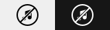

[](https://github.com/zemendes1/nope)

[](https://github.com/zemendes1/nope/releases/latest)
[](https://github.com/zemendes1/nope/releases)
[](https://github.com/zemendes1/nope/blob/master/LICENSE)
[](https://github.com/sponsors/zemendes1)

# nope

nope is a macOS menu bar app that stops built-in apps you never use, like Apple Music or Games, from launching.

Launch nope and those apps won't be able to open, even when macOS tries to open them on its own, for example when your Bluetooth headphones reconnect.

Left-click the menu bar icon to turn it on or off.

nope is based on [noTunes](https://github.com/tombonez/noTunes) by Tom Taylor.

## Installation

### Direct Download

Download the latest release from the [Releases page](https://github.com/zemendes1/nope/releases/latest).

## Usage

### Set noTunes to launch at startup

#### Ventura and later:

1. Navigate to System Settings
2. Select General
3. Select Login Items
4. Click the + under Open at Login and select noTunes

#### Before Ventura:

Navigate to System Preferences -> Users & Groups. Under your user, select "Login Items", click the lock on the bottom left and enter your login password to make changes. Click the plus sign (+) in the main panel and search for noTunes. Select it and click "Add".

### Toggle noTunes Functionality

Left click the menu bar icon to toggle between its active states.

**Enabled (prevents iTunes/Music from opening)**



**Disabled (allows iTunes/Music to open)**


### Hide Menu Bar Icon

Right click or control-click the menu bar icon and click `Hide Icon`.

### Restore Menu Bar Icon

[Quit noTunes](#quit-notunes), run the following command in Terminal and re-open the app:

```bash
defaults delete digital.twisted.noTunes
```

### Quit noTunes

To quit the app either:

**With menu bar icon visible**

Right click or control-click the menu bar icon and click quit.

**With menu bar icon hidden**

Quit the app via Activity Monitor or run the following command in Terminal:

```bash
osascript -e 'quit app "noTunes"'
```

### Set replacement for iTunes / Apple Music

Replace `YOUR_MUSIC_APP` with the name of your music app in the following command.

```bash
defaults write digital.twisted.noTunes replacement /Applications/YOUR_MUSIC_APP.app
```

Then `/Applications/YOUR_MUSIC_APP.app` will launch when iTunes/Music attempts to launch.

This can be used to open a website too, for example, YouTube Music.

```bash
defaults write digital.twisted.noTunes replacement https://music.youtube.com/
```

The following command will disable the replacement.

```bash
defaults delete digital.twisted.noTunes replacement
```

## Support

If you like my work, consider supporting me through [GitHub Sponsors](https://github.com/sponsors/zemendes1) 🩷

## License

The code is available under the [MIT License](https://github.com/zemendes1/nope/blob/master/LICENSE).
